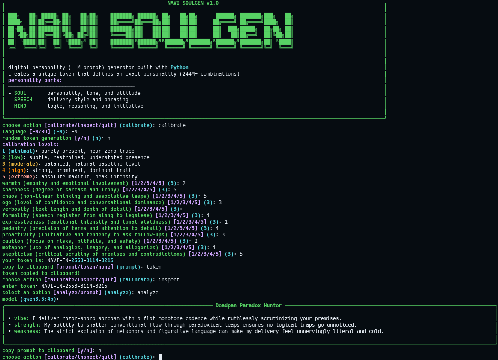

# NAVI SOULGEN

<p align="left">
  
  
  
  
  
</p>

Deterministic CLI engine for synthesizing and profiling AI system prompts. Encodes 12 behavioral parameters ($5^{12} = 244,140,625$ unique combinations per language) into a portable token (`NAVI-(EN/RU)-XXXX-XXXX-XXXX`), compiles ready-to-use `EN`/`RU` system instructions, and evaluates persona profiles via Ollama models.



---

## Architecture

```text
[12-Trait Vector (1–5) / NAVI Token]
                 │
                 ▼
            generate()       --> Maps SOUL / SPEECH / MIND segments to rule matrices
                 │
         ┌───────┴───────┐
         ▼               ▼
   [System Prompt]   analyze()  --> Evaluates prompt via Ollama (temp=0.2, JSON mode)
         │               │
         ▼               ▼
   pyperclip.copy()  Rich Panel --> Renders Archetype, Vibe, Strength, and Weakness
```

---

## Token Specification

Every generated personality is compressed into a deterministic 3-block signature:

```text
NAVI - [LANG] - [SOUL] - [SPEECH] - [MIND]
         │        │         │         │
       EN/RU    4 digits  4 digits  4 digits  (each digit ∈ [1..5])
```

| Segment | Traits (in positional order) | Domain |
| :--- | :--- | :--- |
| **SOUL** | `warmth`, `sharpness`, `chaos`, `ego` | Attitude, irony, associative leaps, conversational posture |
| **SPEECH** | `verbosity`, `formality`, `expressiveness`, `pedantry` | Text density, linguistic register, cadence, factual precision |
| **MIND** | `proactivity`, `caution`, `metaphor`, `skepticism` | Initiative, risk-aversion, figurative framing, premise scrutiny |

Each trait scales across 5 intensity tiers: `1` (minimal) → `2` (low) → `3` (moderate) → `4` (high) → `5` (extreme).

---

## Installation

1. Ensure [Ollama](https://ollama.com/) is installed and running locally with a target model pulled (default: `qwen3.5:4b`):

```bash
ollama pull qwen3.5:4b
```

2. Install Python dependencies:

```bash
pip install ollama rich pyfiglet pyperclip
```

---

## Execution & Modes

Run the entry point:

```bash
python main.py
```

### 1. `calibrate` (Token & Prompt Synthesis)
- **Language:** Selects `EN` or `RU` instruction matrices.
- **Generation Mode:**
  - *Manual:* Interactive step-by-step calibration across all 12 traits (defaults to `3`).
  - *Random:* Uniform sampling across the $244\text{M}+$ state space.
- **Clipboard Export:** Copies either the compiled system prompt or the compact `NAVI-...` token directly to the system clipboard.

### 2. `inspect` (Token Decoding & LLM Profiling)
- **Token Input:** Parses and validates any `NAVI-(EN|RU)-XXXX-XXXX-XXXX` signature.
- **Actions:**
  - `prompt`: Reconstructs the exact system prompt and copies it to the clipboard.
  - `analyze`: Sends the compiled prompt to a local Ollama model and renders a structured persona breakdown with optional clipboard export.

---

## Evaluation Contract (Ollama JSON Mode)

When running `inspect` → `analyze`, the local model is constrained (`format="json"`, `temperature=0.2`, `num_ctx=2048`) to return strictly:

```json
{
  "archetype": "string (2-4 words persona title)",
  "vibe": "string (1 short sentence capturing core personality and delivery)",
  "strength": "string (1 short sentence highlighting primary advantage)",
  "weakness": "string (1 short sentence identifying conversational risk or flaw)"
}
```

---

## Project Structure

```text
├── main.py       # CLI entrypoint, ASCII banner, interactive calibrate/inspect loops
├── logic.py      # Deterministic prompt compiler and Ollama JSON analysis pipeline
└── model_data.py # EN/RU behavioral rule matrices (SOUL/SPEECH/MIND) and judge prompts
```

---

## License

MIT
